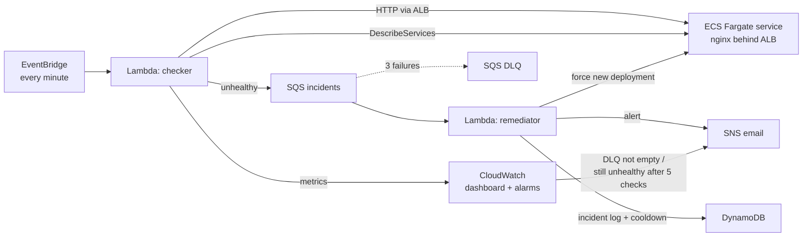

# aws-auto-remediation

Self-healing for a containerised service on AWS. A scheduled checker detects when the service is unhealthy. A queue-driven remediator fixes it, records the incident and alerts a human. Alarms watch the automation itself. The whole setup is Terraform.



## What it does

1. **Detect.** Every minute, the `checker` Lambda calls the service through its load balancer and compares the ECS service's running and desired task counts. Each result goes to CloudWatch (`Healthy`, `LatencyMs`), and unhealthy targets are put on SQS.
2. **Remediate.** The `remediator` Lambda forces a new ECS deployment, which gives fresh tasks with fresh health checks. It then writes the incident to DynamoDB and sends an SNS alert.
3. **Guard rails.**
   - A **cooldown** (10 minutes by default) stops a flapping service from being redeployed every minute.
   - **Partial batch failures**: one bad message doesn't make the whole batch retry.
   - A **dead-letter queue** catches incidents that fail 3 times.
4. **Watch the watcher.** Two alarms page a human:
   - the DLQ has messages (the remediation itself is failing);
   - the service is still unhealthy after 5 checks, or the checker stopped sending metrics.

## Services used

ECS Fargate · Application Load Balancer · Lambda (Python 3.12) · EventBridge · SQS + DLQ · DynamoDB · SNS · CloudWatch (metrics, alarms, dashboard, logs) · IAM (one least-privilege role per function) · Terraform · GitHub Actions

## Run it

Requirements: an AWS account, AWS CLI credentials, Terraform ≥ 1.5.

```bash
cd terraform
terraform init
terraform apply -var="alert_email=you@example.com"   # confirm the SNS email AWS sends you
```

Open the `app_url` output and you should see the nginx welcome page.

### Cause an outage and watch it heal

```bash
CLUSTER=$(terraform output -raw ecs_cluster); SERVICE=$(terraform output -raw ecs_service)
TASK=$(aws ecs list-tasks --cluster $CLUSTER --service-name $SERVICE --query 'taskArns[0]' --output text)
aws ecs stop-task --cluster $CLUSTER --task $TASK --reason "chaos test"
```

Within about a minute:
- the load balancer returns **503**, the checker logs `running 0/1`, and the incident goes on the queue;
- the remediator forces a redeploy, you get an email, and a row appears in the incident table;
- the dashboard (`dashboard_url` output) shows `Healthy` dropping to 0 and then recovering.

### Tear it down

The load balancer and Fargate task together cost about **$1 a day**. Remove everything when you're done:

```bash
terraform destroy
```

## Tests

```bash
pip install -r requirements-dev.txt
pytest -q
```

Handlers take their AWS clients as parameters, so the tests use in-memory fakes, plus a real local HTTP server for the health check. CI runs the tests and `terraform fmt -check` / `validate` on every push.

## Design notes

- **Detect and fix are separate, connected by a queue.** The checker stays fast and simple. Remediation gets retries, a DLQ and back-pressure for free, and either side can change without touching the other.
- **Least privilege.** The checker can only send to one queue, describe one service and write metrics in one namespace. The remediator can only update that one service, read and write one table, and publish to one topic.
- **The automation is monitored too.** Auto-remediation that fails silently is worse than none, so a failing remediator or a dead checker alerts a human.
- **A demo shortcut, stated plainly:** the service runs in the default VPC with public IPs to avoid NAT gateway costs. In production it would run in private subnets.

## Next steps

- Remote state in S3 with DynamoDB locking, and a GitHub Actions deploy job using OIDC (no stored keys).
- Multiple targets loaded from SSM Parameter Store instead of an environment variable.
- A runbook link in each alert, plus Slack alerts via AWS Chatbot.
